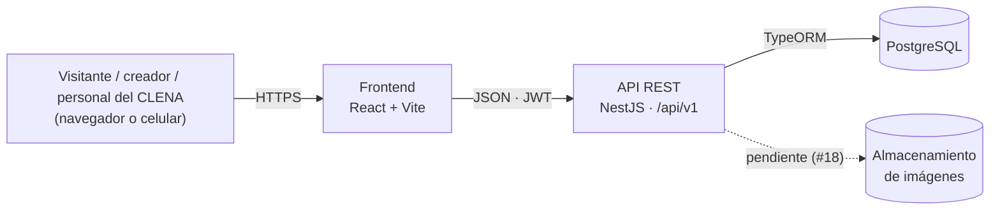
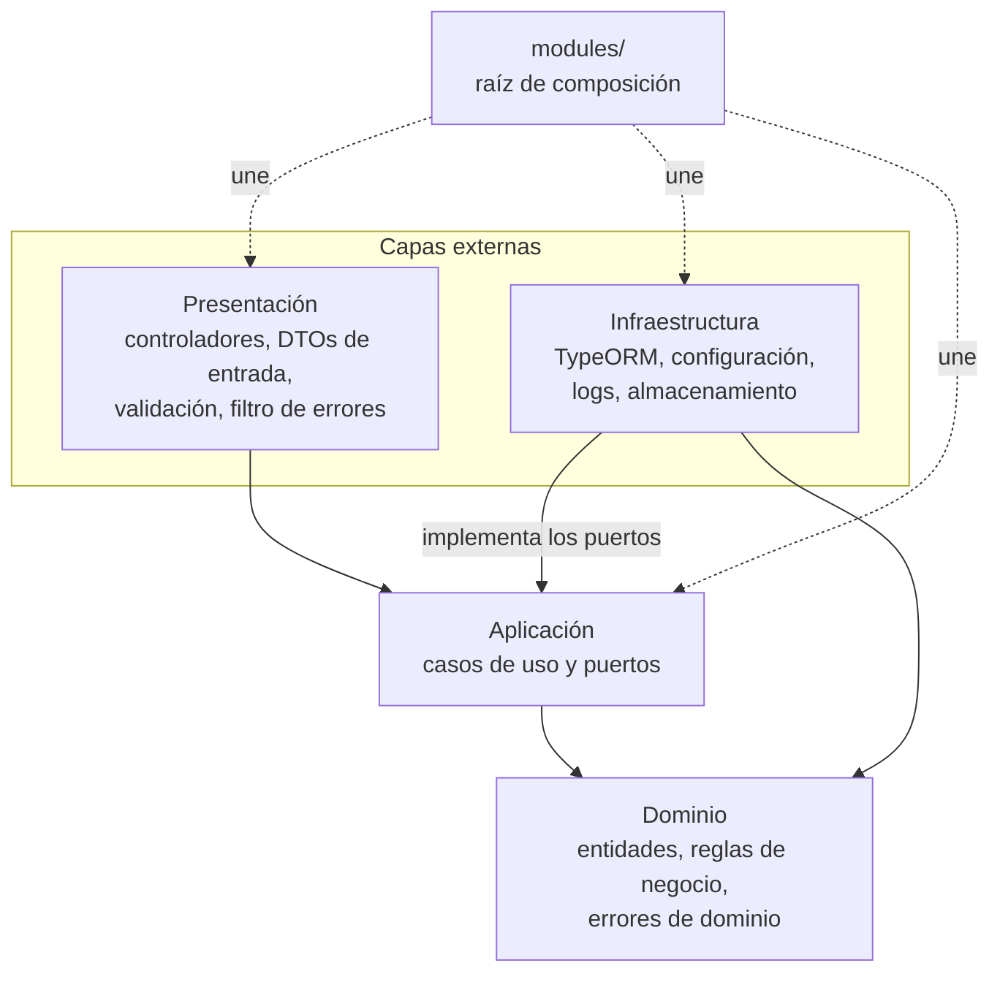
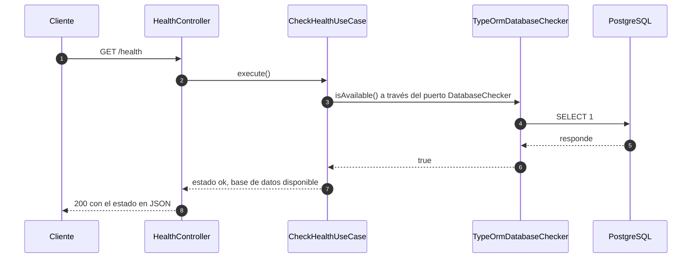

# Arquitectura

Este documento describe cómo está construido el sistema del recorrido interactivo del CLENA: sus componentes, las capas del backend, cómo viaja una petición y por qué se tomó cada decisión técnica.

## 1. Vista general

El repositorio es un monorepo con dos aplicaciones:

| Carpeta | Qué es | Tecnología |
|---|---|---|
| `frontend/` | Aplicación web que usan los visitantes, los creadores de recorridos y el personal del CLENA | React 19 + TypeScript, con Vite |
| `backend/` | API REST que guarda los recorridos, las escenas y los usuarios | NestJS 12 + TypeScript, con Clean Architecture |



- El frontend solo habla con la API; nunca accede a la base de datos.
- La API expone sus rutas de negocio bajo `/api/v1`, la documentación Swagger en `/docs` y el estado del sistema en `/health`.
- El navegador solo puede llamar a la API desde los orígenes permitidos en `CORS_ORIGIN`.
- El almacenamiento de las fotos de las escenas se define con la historia #18.

## 2. Capas del backend

El backend sigue Clean Architecture: el código se divide en cuatro capas y **las dependencias siempre apuntan hacia el dominio**. Ninguna capa interna conoce a una externa.



| Capa | Carpeta | Contiene | Puede depender de |
|---|---|---|---|
| Dominio | `src/domain/` | Entidades, objetos de valor, reglas de negocio y errores de dominio. TypeScript puro. | Nada |
| Aplicación | `src/application/` | Un caso de uso por acción del negocio y los puertos (interfaces) que necesita, por ejemplo un repositorio. | Dominio |
| Infraestructura | `src/infrastructure/` | Implementación de los puertos: repositorios con TypeORM, entidades de persistencia, migraciones, configuración y logs. | Dominio y aplicación |
| Presentación | `src/presentation/` | Controladores REST, DTOs de entrada con validación, guards y el filtro global de errores. Solo invoca casos de uso. | Aplicación y dominio |
| Composición | `src/modules/` | Módulos de NestJS que conectan cada puerto con su implementación. Ninguna capa la importa. | Todas |

### Cómo se hace cumplir la regla de dependencia

La regla no depende de la buena voluntad: `npm run lint` falla si alguien la rompe. Está configurada con `no-restricted-imports` en `backend/.oxlintrc.json`:

| Archivos en | No pueden importar |
|---|---|
| `src/domain/` | NestJS, TypeORM, `pg`, class-validator, class-transformer, pino, Express ni ninguna otra capa |
| `src/application/` | Esas mismas librerías, ni `infrastructure/`, `presentation/` o `modules/` |
| `src/presentation/` | TypeORM, `pg`, `infrastructure/` ni `modules/` |

Cuando el CI ejecute el lint en cada Pull Request, una violación no podrá llegar a `main`.

### Inyección de dependencias con tokens

Los casos de uso son clases sin decoradores de NestJS: reciben sus dependencias por el constructor, tipadas con la interfaz del puerto. El módulo decide qué implementación se usa mediante un token. Así el caso de uso se puede probar con un objeto falso y la infraestructura se puede cambiar sin tocarlo.

El módulo de salud es el ejemplo de referencia (`backend/src/modules/health.module.ts`):

```ts
@Module({
  controllers: [HealthController],
  providers: [
    // El puerto DatabaseChecker se implementa con TypeORM
    { provide: DATABASE_CHECKER, useClass: TypeOrmDatabaseChecker },
    // El caso de uso recibe el puerto, no la implementación
    {
      provide: CheckHealthUseCase,
      inject: [DATABASE_CHECKER],
      useFactory: (databaseChecker: DatabaseChecker) =>
        new CheckHealthUseCase(databaseChecker),
    },
  ],
})
export class HealthModule {}
```

Los repositorios de las historias siguientes (#15 usuarios, #17 recorridos) siguen exactamente este patrón. Las entidades de TypeORM (`*.orm-entity.ts`) se convierten a entidades de dominio con un mapper y nunca salen de la capa de infraestructura.

## 3. Estructura de carpetas

```
backend/
├── src/
│   ├── domain/
│   │   └── errors/                  Errores de dominio
│   ├── application/
│   │   └── health/
│   │       ├── ports/               Interfaces que el caso de uso necesita
│   │       └── check-health.use-case.ts
│   ├── infrastructure/
│   │   ├── config/                  Validación de variables de entorno
│   │   ├── database/                Conexión, fuente de datos y migraciones
│   │   ├── health/                  Implementación del puerto con TypeORM
│   │   └── logging/                 Configuración de pino
│   ├── presentation/
│   │   └── http/
│   │       ├── errors/              Filtro global y formato de error
│   │       ├── validation/          Tubería de validación de DTOs
│   │       ├── health/              Controlador y DTO de respuesta
│   │       └── configure-app.ts     Prefijo, validación, filtro y Swagger
│   ├── modules/                     Raíz de composición
│   ├── app.module.ts
│   └── main.ts
└── test/                            Pruebas e2e
```

Cada módulo nuevo agrega su carpeta en las capas que necesite: `domain/<module>/`, `application/<module>/`, `infrastructure/<module>/`, `presentation/http/<module>/` y `modules/<module>.module.ts`.

### Convenciones de nombres

| Qué | Idioma | Ejemplo |
|---|---|---|
| Clases, archivos, carpetas, funciones y variables | Inglés | `CheckHealthUseCase`, `check-health.use-case.ts` |
| Campos del JSON de respuesta | Español | `estado`, `codigo`, `mensaje` |
| Códigos de error | Español | `NO_ENCONTRADO`, `VALIDACION` |
| Mensajes al usuario, comentarios y descripciones de pruebas | Español | `'Los datos enviados no son válidos'` |

| Tipo de archivo | Sufijo |
|---|---|
| Caso de uso | `<accion>.use-case.ts` |
| Puerto | `ports/<nombre>.ts` (interfaz y token) |
| Entidad de persistencia | `<nombre>.orm-entity.ts` |
| Controlador | `<nombre>.controller.ts` |
| DTO de respuesta | `<nombre>.response.ts` |
| Prueba unitaria / e2e | `*.spec.ts` / `test/*.e2e-spec.ts` |

## 4. Flujo de una petición

Así se atiende `GET /health`. Las demás rutas siguen el mismo camino, con un repositorio en lugar del verificador de base de datos.



Si la base de datos no responde, el caso de uso devuelve `"degradado"` y el controlador responde **503**.

En las rutas que reciben datos, antes del controlador actúa la tubería de validación: si el DTO no es válido, la petición no llega al caso de uso y se responde 400.

### Manejo de errores

Toda excepción termina en `GlobalExceptionFilter`, que responde siempre con el mismo formato:

```json
{
  "estado": 404,
  "codigo": "RECURSO_NO_ENCONTRADO",
  "mensaje": "Recorrido con id 7 no existe",
  "ruta": "/api/v1/recorridos/7",
  "fecha": "2026-11-04T12:00:00.000Z"
}
```

| Origen del error | Estado HTTP | Código |
|---|---|---|
| DTO inválido (validación) | 400 | `VALIDACION`, con `detalles` por campo |
| `AccessDeniedError` (dominio) | 403 | `ACCESO_DENEGADO` |
| `ResourceNotFoundError` (dominio) | 404 | `RECURSO_NO_ENCONTRADO` |
| `BusinessRuleError` (dominio) | 422 | `REGLA_DE_NEGOCIO` o un código propio |
| Excepciones HTTP de NestJS | El de la excepción | Código en español según el estado |
| Cualquier otro error | 500 | `ERROR_INTERNO`, sin detalles internos; se registra en los logs |

El dominio lanza errores que no saben nada de HTTP; la traducción a códigos de estado ocurre solo en la capa de presentación.

## 5. Decisiones técnicas

El stack (NestJS, React, PostgreSQL y Docker) es obligatorio según el enunciado del curso. Estas son las decisiones que sí tomó el equipo:

| Decisión | Alternativas | Por qué |
|---|---|---|
| **TypeORM** como ORM | Prisma | Sus entidades son clases con decoradores, que encajan con NestJS y con el patrón de repositorio por puerto. Genera migraciones a partir de las entidades. |
| **Casos de uso sin decoradores**, creados con `useFactory` | Marcar los casos de uso con `@Injectable()` | Mantiene la capa de aplicación libre de NestJS, como exige Clean Architecture, y la hace fácil de probar. |
| **Migraciones con `synchronize: false`** | `synchronize: true` | El esquema solo cambia con migraciones versionadas, que quedan en el historial y se pueden revertir. El enunciado prohíbe `synchronize` fuera de desarrollo local; se desactivó en todos los entornos para que no haya diferencias. |
| **class-validator** con una tubería global | Validar a mano en cada controlador | Toda entrada se valida igual. La tubería rechaza campos que no están en el DTO, lo que evita que un cliente modifique datos que no debe. |
| **Validación de variables de entorno al arrancar** | Leer `process.env` donde se necesite | Si falta una variable o tiene un valor inválido, la API no arranca y dice cuál es, en vez de fallar después en producción. |
| **Logs JSON con pino** (`nestjs-pino`) | Logger por defecto de NestJS | Los logs estructurados se pueden filtrar y buscar en el despliegue. Cada petición queda con método, ruta, estado y duración; las cabeceras `authorization` y `cookie` se ocultan. |
| **Swagger generado desde el código** (`@nestjs/swagger`) | Escribir la documentación a mano | La documentación de `/docs` siempre coincide con la API real. |
| **Vitest** para pruebas | Jest | Es el que trae la plantilla de NestJS 12, funciona con módulos ES de forma nativa y es más rápido. |
| **oxlint** para lint | ESLint | Es el que trae la plantilla de NestJS 12. Soporta `no-restricted-imports` por carpeta, que es lo que hace cumplir la regla de dependencia. |
| **Módulos ES** (`"type": "module"`) | CommonJS | Es el formato por defecto de NestJS 12. Por eso los imports relativos terminan en `.js`. |
| **`/health` fuera de `/api/v1`** | Ponerlo bajo el prefijo | Las herramientas de despliegue y monitoreo consultan una ruta fija que no cambia con la versión de la API. |
| **Node.js 22** | Node.js 20 | Versión LTS vigente. El backend la exige en `engines` (22.12 o superior) para que todo el equipo y el despliegue usen la misma. |

### Calidad

- **Pruebas unitarias** del dominio y de los casos de uso, con meta de cobertura de 70 % en esas capas (`npm run test:cov` falla por debajo).
- **Pruebas e2e** de la API con Supertest. Usan la misma configuración que producción (`configureApp`) y reemplazan los puertos por objetos falsos, así que no necesitan base de datos.
- **Lint, pruebas y build** deben pasar antes de fusionar a `main`. GitHub Actions los ejecutará en cada Pull Request cuando esté configurado el CI.

## 6. Seguridad

| Tema | Cómo se resuelve | Estado |
|---|---|---|
| Autenticación | JWT con access token de vida corta y refresh token para renovarlo | Planeado en #15 |
| Contraseñas | Guardadas solo como hash (argon2 o bcrypt) | Planeado en #15 |
| Autorización | Guards de NestJS por rol, con los perfiles del backlog: el **visitante** no tiene cuenta y solo mira recorridos; el **creador** (`creator`) tiene cuenta y crea sus recorridos; el **personal del CLENA** (`staff`) edita el recorrido oficial; el **administrador** (`admin`) maneja roles y modera | Planeado en #15 y #24 |
| Datos personales | Consentimiento explícito y aviso de privacidad al registrarse, y opción de eliminar la cuenta (Ley 1581 de 2012) | Planeado en #15 y #16 |
| Secretos | Solo por variables de entorno. En el repositorio solo está `backend/.env.example`, sin valores reales; `.env` está en el `.gitignore` | Hecho |
| Entrada de datos | Validación de todos los DTOs; se rechazan campos desconocidos | Hecho |
| Errores | Los errores inesperados responden 500 sin mensajes internos | Hecho |
| CORS | Solo se aceptan los orígenes configurados en `CORS_ORIGIN` | Hecho |
| Logs | Se ocultan las cabeceras `authorization` y `cookie` | Hecho |

### Requisito para el despliegue: frontend y API en el mismo sitio

La sesión se renueva con un refresh token que viaja en una cookie `httpOnly` con `SameSite=Strict` (#15). El navegador solo envía esa cookie cuando el frontend y la API están en el **mismo sitio**, es decir, bajo el mismo dominio registrado. Si no se cumple, el inicio de sesión funciona, pero la sesión se pierde al recargar la página.

| Despliegue | ¿Funciona? |
|---|---|
| Frontend y API en el mismo dominio, con la API detrás de un proxy en `/api` | Sí |
| Subdominios del mismo dominio, por ejemplo `app.clena.co` y `api.clena.co` | Sí |
| En desarrollo, `localhost:5173` y `localhost:3000` | Sí (el puerto no cuenta) |
| Dominios distintos, por ejemplo `clena.vercel.app` y `clena-api.onrender.com` | No |
| Dos subdominios de un servicio de hosting, por ejemplo `app.vercel.app` y `api.vercel.app` | No: esos servicios cuentan cada subdominio como un sitio distinto |

Además, `CORS_ORIGIN` debe tener la dirección exacta del frontend, y en producción la API debe servirse por HTTPS, porque la cookie se marca como `Secure`.

## 7. Decisiones pendientes

- **Almacenamiento de las imágenes de las escenas** (#18): disco local montado en Docker o un servicio de objetos. Lo define la persona de datos.
- **Paginación, filtros y orden reutilizables** para los listados (#21 y #23).
- **Despliegue y `docker-compose`**: lo define la persona de DevOps y se documenta en `docs/manual-operacion.md`. Debe cumplir el [requisito del mismo sitio](#requisito-para-el-despliegue-frontend-y-api-en-el-mismo-sitio).
- **Modelo de datos**: se documenta en `docs/modelo-datos.md`.
