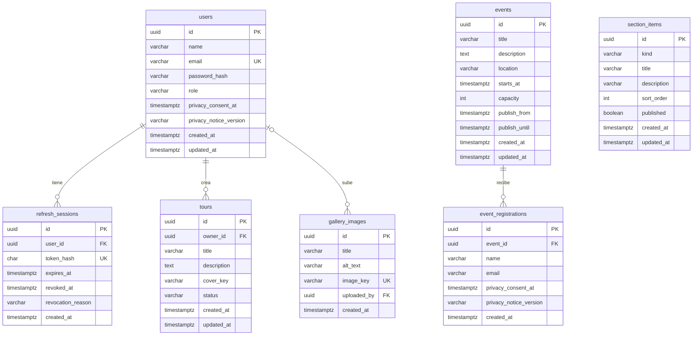

# Modelo de datos

Este documento describe la base de datos del sistema del recorrido interactivo del CLENA: qué tablas existen, qué guarda cada columna, cómo se relacionan y por qué se diseñaron así.

Está escrito a partir del esquema real: se ejecutaron las migraciones en un PostgreSQL 16 limpio y se comparó cada tabla con lo que aquí se dice. Para el diseño de las capas del backend, ver el documento de arquitectura ([`arquitectura.md`](arquitectura.md), historia #29), y para las reglas de negocio y el glosario, el [modelo de dominio](modelo-dominio.pdf) (#78).

## 1. Vista general

- **Motor:** PostgreSQL 15 o superior, con TypeORM.
- **Cómo cambia el esquema:** solo con migraciones escritas a mano en `backend/src/infrastructure/database/migrations/`. La opción `synchronize` está siempre en `false`, así que ningún arranque de la aplicación modifica las tablas por su cuenta.
- **Historial de migraciones:** TypeORM lo guarda en la tabla `migraciones` (no pertenece al negocio).
- **Archivos:** las imágenes **no** viven en la base de datos. Se guardan en disco y la base solo conserva su clave (ver la sección 5).

- **Datos de ejemplo:** dos migraciones (`SeedSectionItems` y `SeedEvents`) cargan contenido de demostración, y corren también en producción. Las fechas de los eventos de ejemplo se calculan **el día en que se ejecuta la migración**, así que son relativas a ese día (ver la sección 3.5).

Hoy hay siete tablas de negocio:

| Tabla | Para qué sirve | Historia |
|---|---|---|
| `users` | Cuentas de las personas que usan el sistema | #15 |
| `refresh_sessions` | Sesiones abiertas de cada cuenta (refresh tokens) | #15 |
| `tours` | Recorridos creados por los usuarios | #17 |
| `gallery_images` | Imágenes de la galería del CLENA | #47, #48 |
| `events` | Eventos de la agenda del CLENA | #44, #45 |
| `event_registrations` | Personas inscritas a cada evento | #46 |
| `section_items` | Espacios, servicios y horarios de la landing | #42, #43 |

## 2. Diagrama entidad-relación



`section_items` no se relaciona con ninguna tabla: es contenido de la landing que edita el personal. `event_registrations` tampoco apunta a `users`: la persona se identifica por su correo (ver la sección 4).

Cómo leer las líneas entre tablas:

- `||--o{` significa "uno a muchos": un usuario tiene cero o muchas sesiones, y cada sesión pertenece a exactamente un usuario. Lo mismo vale para `tours`, y para un evento y sus inscripciones.
- `|o--o{` en `gallery_images` significa que cada imagen tiene **cero o un** usuario que la subió. Es opcional porque, si se elimina la cuenta, la imagen se queda y solo se pierde el vínculo (ver la sección 4).

## 3. Tablas

### 3.1 `users`

Una fila por cuenta. Contiene datos personales, así que está cubierta por la Ley 1581 de 2012.

| Columna | Tipo | ¿Obligatoria? | Qué guarda |
|---|---|---|---|
| `id` | `uuid` | Sí | Identificador. Lo genera la aplicación, no la base |
| `name` | `varchar(100)` | Sí | Nombre de la persona |
| `email` | `varchar(254)` | Sí | Correo. Es único y sirve para iniciar sesión |
| `password_hash` | `varchar(255)` | Sí | Hash de la contraseña con argon2id. Nunca la contraseña |
| `role` | `varchar(20)` | Sí | `admin`, `staff` o `public` |
| `privacy_consent_at` | `timestamptz` | Sí | Cuándo aceptó el aviso de privacidad |
| `privacy_notice_version` | `varchar(30)` | Sí | Versión del aviso que aceptó |
| `created_at` | `timestamptz` | Sí | Cuándo se creó la cuenta |
| `updated_at` | `timestamptz` | Sí | Última modificación (por defecto `now()`) |

Restricciones e índices:

- `PK_users`: clave primaria en `id`.
- `UQ_users_email`: no puede haber dos cuentas con el mismo correo. Además crea el índice que acelera buscar una cuenta por correo al iniciar sesión.
- `CHK_users_role`: solo acepta los tres roles del sistema (administrador, personal del CLENA y usuario público).

Por qué el consentimiento tiene fecha y versión: la Ley 1581 exige poder demostrar **qué** aviso aceptó cada persona y **cuándo**. Si el texto del aviso cambia, las cuentas anteriores siguen mostrando la versión que aceptaron. La versión actual es provisional (`2026-11-provisional`) hasta que el equipo apruebe el texto definitivo.

### 3.2 `refresh_sessions`

Una fila por sesión abierta. La aplicación entrega al navegador un *refresh token* (una cookie) que permite renovar el acceso sin volver a escribir la contraseña. La base **nunca guarda el token**, solo su huella.

| Columna | Tipo | ¿Obligatoria? | Qué guarda |
|---|---|---|---|
| `id` | `uuid` | Sí | Identificador de la sesión |
| `user_id` | `uuid` | Sí | Cuenta a la que pertenece |
| `token_hash` | `char(64)` | Sí | Huella SHA-256 del token, en hexadecimal (64 caracteres) |
| `expires_at` | `timestamptz` | Sí | Cuándo caduca la sesión |
| `revoked_at` | `timestamptz` | No | Cuándo se cerró. Vacía mientras la sesión sigue activa |
| `revocation_reason` | `varchar(20)` | No | Por qué se cerró: `rotated`, `logged_out` o `reuse_detected` |
| `created_at` | `timestamptz` | Sí | Cuándo se abrió |

Restricciones e índices:

- `PK_refresh_sessions`: clave primaria en `id`.
- `UQ_refresh_sessions_token_hash`: no hay dos sesiones con la misma huella, y permite encontrar la sesión a partir del token que llega.
- `IDX_refresh_sessions_user_id`: PostgreSQL **no** crea índices solos para las llaves foráneas. Este sirve para buscar las sesiones de una cuenta y para que el borrado en cascada sea rápido.
- `CHK_refresh_sessions_revocation_reason`: solo acepta los tres motivos conocidos.
- `FK_refresh_sessions_user_id`: apunta a `users`, con borrado en cascada (sección 4).

Por qué guardar la huella y no el token: si alguien copiara la base de datos, no podría usar las huellas para entrar. Un token de 256 bits generado al azar no se puede adivinar, así que una huella rápida (SHA-256) es suficiente. Las contraseñas, en cambio, sí necesitan un hash lento (argon2id), porque las personas eligen contraseñas adivinables.

### 3.3 `tours`

Una fila por recorrido creado por un usuario. Todo recorrido nace como borrador y mientras lo sea solo lo ve su creador.

| Columna | Tipo | ¿Obligatoria? | Qué guarda |
|---|---|---|---|
| `id` | `uuid` | Sí | Identificador del recorrido |
| `owner_id` | `uuid` | Sí | Usuario que lo creó |
| `title` | `varchar(120)` | Sí | Título |
| `description` | `text` | Sí | Descripción (vacía por defecto; la aplicación limita a 2000 caracteres) |
| `cover_key` | `varchar(255)` | No | Clave del archivo de portada, por ejemplo `covers/<uuid>.jpg`. Vacía si no tiene portada |
| `status` | `varchar(20)` | Sí | `draft` (borrador) o `published` (publicado) |
| `created_at` | `timestamptz` | Sí | Cuándo se creó |
| `updated_at` | `timestamptz` | Sí | Última modificación |

Restricciones e índices:

- `PK_tours`: clave primaria en `id`.
- `CHK_tours_status`: solo acepta `draft` y `published`.
- `IDX_tours_owner_id_created_at`: índice compuesto sobre `(owner_id, created_at)`. Responde la consulta "mis recorridos, del más reciente al más antiguo": primero filtra por dueño y las filas ya salen ordenadas por fecha.
- `FK_tours_owner_id`: apunta a `users`, con borrado en cascada (sección 4).

### 3.4 `gallery_images`

Una fila por imagen de la galería pública del CLENA. Las suben el personal y los administradores; las ve cualquier persona.

| Columna | Tipo | ¿Obligatoria? | Qué guarda |
|---|---|---|---|
| `id` | `uuid` | Sí | Identificador de la imagen |
| `title` | `varchar(120)` | Sí | Título |
| `alt_text` | `varchar(250)` | Sí | Texto alternativo para lectores de pantalla (accesibilidad) |
| `image_key` | `varchar(255)` | Sí | Clave del archivo, por ejemplo `gallery/<uuid>.png` |
| `uploaded_by` | `uuid` | No | Usuario que la subió. Queda vacía si esa cuenta se elimina |
| `created_at` | `timestamptz` | Sí | Cuándo se subió |

Restricciones e índices:

- `PK_gallery_images`: clave primaria en `id`.
- `UQ_gallery_images_image_key`: cada archivo pertenece a una sola fila.
- `IDX_gallery_images_created_at_id`: índice sobre `(created_at, id)`. Sirve al listado público paginado por fecha; el `id` desempata cuando dos imágenes tienen la misma fecha, para que ninguna se repita ni se salte al cambiar de página.
- `FK_gallery_images_uploaded_by`: apunta a `users`, con `ON DELETE SET NULL` (sección 4).

### 3.5 `events`

Una fila por evento de la agenda del CLENA. La tabla ya existe y las inscripciones (#46) dependen de ella, pero la aplicación todavía **no tiene** pantalla ni endpoint para crear eventos (historias #44 y #45): hoy solo existen los eventos de ejemplo.

| Columna | Tipo | ¿Obligatoria? | Qué guarda |
|---|---|---|---|
| `id` | `uuid` | Sí | Identificador del evento |
| `title` | `varchar(150)` | Sí | Título |
| `description` | `text` | Sí | Descripción (vacía por defecto) |
| `location` | `varchar(150)` | Sí | Lugar dentro del complejo |
| `starts_at` | `timestamptz` | Sí | Cuándo empieza |
| `capacity` | `integer` | Sí | Cupo máximo de inscritos |
| `publish_from` | `timestamptz` | Sí | Desde cuándo aparece en la agenda |
| `publish_until` | `timestamptz` | Sí | Hasta cuándo aparece en la agenda |
| `created_at` | `timestamptz` | Sí | Cuándo se creó |
| `updated_at` | `timestamptz` | Sí | Última modificación |

Restricciones e índices:

- `PK_events`: clave primaria en `id`.
- `CHK_events_capacity`: el cupo debe ser mayor que cero.
- `CHK_events_publish_period`: `publish_until` no puede ser anterior a `publish_from`.
- `IDX_events_starts_at`: índice sobre `starts_at`. La agenda lista los eventos por fecha, el más próximo primero.

Un evento está vigente cuando la fecha actual está entre `publish_from` y `publish_until`; solo entonces acepta inscripciones. Esas dos fechas son independientes de `starts_at`, así que un evento se puede anunciar con anticipación. En los eventos de ejemplo la publicación termina cuando el evento empieza.

El cupo se respeta incluso con inscripciones simultáneas: el repositorio abre una transacción, bloquea la fila del evento (`SELECT … FOR UPDATE`), cuenta las inscripciones y guarda la nueva solo si todavía hay lugar. Las inscripciones al mismo evento esperan su turno, y si está lleno se responde `EVENTO_SIN_CUPOS`.

**Eventos de ejemplo.** La migración `SeedEvents` inserta cinco, con fechas relativas al día en que se ejecuta y en hora de Colombia: uno a 10 días, uno a 5 días con cupo de 3 (para probar el cupo lleno), uno a 20 días, uno que todavía no se publica (`publish_from` es 7 días después) y uno que ya pasó. Como corre también en producción, esos eventos quedan en la agenda real mientras no se eliminen.

### 3.6 `event_registrations`

Una fila por persona inscrita a un evento. No hace falta tener cuenta: solo se guarda el **mínimo** de datos personales, que está cubierto por la Ley 1581 de 2012.

| Columna | Tipo | ¿Obligatoria? | Qué guarda |
|---|---|---|---|
| `id` | `uuid` | Sí | Identificador de la inscripción |
| `event_id` | `uuid` | Sí | Evento al que se inscribió |
| `name` | `varchar(100)` | Sí | Nombre de la persona |
| `email` | `varchar(254)` | Sí | Correo de contacto |
| `privacy_consent_at` | `timestamptz` | Sí | Cuándo aceptó el aviso de privacidad |
| `privacy_notice_version` | `varchar(30)` | Sí | Versión del aviso que aceptó |
| `created_at` | `timestamptz` | Sí | Cuándo se inscribió |

Restricciones e índices:

- `PK_event_registrations`: clave primaria en `id`.
- `UQ_event_registrations_event_id_email`: una misma persona no puede inscribirse dos veces al mismo evento. Como empieza por `event_id`, también sirve de índice para listar los inscritos de un evento, y por eso no hay un índice aparte.
- `FK_event_registrations_event_id`: apunta a `events`, con borrado en cascada (sección 4).

El consentimiento lleva fecha y versión por la misma razón que en `users`: poder demostrar qué aviso aceptó cada persona y cuándo.

### 3.7 `section_items`

Una fila por elemento de las secciones de la landing: un espacio del complejo, un servicio o una línea de horario. Los administra el personal desde el panel.

| Columna | Tipo | ¿Obligatoria? | Qué guarda |
|---|---|---|---|
| `id` | `uuid` | Sí | Identificador del elemento |
| `kind` | `varchar(20)` | Sí | Sección a la que pertenece: `space`, `service` o `schedule` |
| `title` | `varchar(120)` | Sí | Título |
| `description` | `varchar(1000)` | Sí | Descripción |
| `sort_order` | `integer` | Sí | Posición dentro de su sección (de 0 a 999) |
| `published` | `boolean` | Sí | Si se muestra en la landing o es un borrador |
| `created_at` | `timestamptz` | Sí | Cuándo se creó |
| `updated_at` | `timestamptz` | Sí | Última modificación |

Restricciones e índices:

- `PK_section_items`: clave primaria en `id`.
- `CHK_section_items_kind`: solo acepta los tres tipos de sección.
- `CHK_section_items_sort_order`: el orden va de 0 a 999.
- `IDX_section_items_published_kind_order`: índice sobre `(published, kind, sort_order)`. La landing pide los elementos publicados de una sección, ya en su orden, y este índice responde esa consulta sin ordenar después.

La migración `SeedSectionItems` carga el contenido inicial: 5 espacios, 3 servicios y 2 horarios, todos publicados.

## 4. Relaciones y qué pasa al eliminar una cuenta

Tres relaciones salen de `users` y una sale de `events`. Lo importante es qué hace la base cuando se elimina una cuenta (por ejemplo con la historia #16, eliminar mi cuenta) o un evento:

| Relación | Al eliminar el usuario | Por qué |
|---|---|---|
| `refresh_sessions.user_id` → `users.id` | **Se eliminan** sus sesiones (`CASCADE`) | Una sesión sin cuenta no sirve para nada |
| `tours.owner_id` → `users.id` | **Se eliminan** sus recorridos (`CASCADE`) | Son contenido personal de la cuenta; la Ley 1581 da derecho a que se supriman los datos |
| `gallery_images.uploaded_by` → `users.id` | La imagen **se conserva** y `uploaded_by` queda en `NULL` (`SET NULL`) | La imagen es contenido del CLENA, no de la persona. Solo se borra el vínculo con ella |
| `event_registrations.event_id` → `events.id` | Al eliminar un **evento** se eliminan sus inscripciones (`CASCADE`) | Una inscripción no tiene sentido sin el evento |

**Importante (archivos):** el borrado en cascada elimina **filas**, pero no **archivos**. Las portadas de los recorridos eliminados siguen en disco. El caso de uso de eliminar cuenta (#16) debe borrar esos archivos por su cuenta, antes de borrar al usuario.

**Importante (inscripciones):** `event_registrations` **no** tiene llave foránea a `users`. Una persona se inscribe con nombre y correo, tenga cuenta o no, así que la base no sabe qué inscripciones son de qué cuenta. Al eliminar una cuenta, esas filas **no se borran solas**: el caso de uso #16 tendría que buscarlas por correo (`email`) y eliminarlas, porque son datos personales de la misma persona. Esto está por decidir con el equipo, porque la historia #16 todavía no está implementada.

## 5. Los archivos no están en la base

Las imágenes se guardan en disco, en la carpeta `STORAGE_DIR` (ver [`backend/README.md`](../backend/README.md)). La base solo conserva la **clave** del archivo, nunca la URL:

| Columna | Carpeta en disco | Ejemplo de clave |
|---|---|---|
| `tours.cover_key` | `covers/` | `covers/7d0c2f4e-….jpg` |
| `gallery_images.image_key` | `gallery/` | `gallery/7d0c2f4e-….png` |

La URL pública (`/archivos/<clave>`) se calcula al responder, a partir de la clave y de la variable `PUBLIC_BASE_URL`. Así, si el dominio cambia o se mueven los archivos a otro servicio, no hay que migrar ningún dato.

Estas columnas **no** son llaves foráneas: la base no puede comprobar que el archivo exista. Por eso la aplicación guarda primero el archivo y después la fila, y si falla la base borra el archivo recién subido para no dejarlo huérfano.

## 6. Datos personales que se guardan y por qué

La Ley 1581 de 2012 pide guardar solo los datos necesarios para una finalidad clara. Estos son todos los datos de una persona que están en la base:

| Dato | Tabla | Para qué se guarda | Cuándo se elimina |
|---|---|---|---|
| Nombre y correo de la cuenta | `users` | Crear la cuenta e iniciar sesión | Con la cuenta (#16) |
| Hash de la contraseña (nunca la contraseña) | `users` | Comprobar la contraseña al iniciar sesión | Con la cuenta (#16) |
| Fecha y versión del aviso de privacidad aceptado | `users` y `event_registrations` | Demostrar qué aviso aceptó cada persona y cuándo | Con la cuenta o con la inscripción |
| Huella de la sesión y su fecha de caducidad | `refresh_sessions` | Mantener la sesión abierta sin pedir la contraseña otra vez | Con la cuenta, en cascada |
| Nombre y correo de quien se inscribe | `event_registrations` | Reservar el cupo y enviar la confirmación | Con el evento, en cascada; por cuenta, pendiente (sección 4) |
| Recorridos que crea la persona | `tours` | Que cada quien administre sus recorridos | Con la cuenta, en cascada |
| Quién subió una imagen | `gallery_images.uploaded_by` | Saber quién la subió | Queda vacío si se elimina la cuenta |

No se guarda ningún teléfono, documento de identidad, dirección ni dato de pago.

## 7. Decisiones de diseño

| Decisión | Motivo |
|---|---|
| Identificadores `uuid` generados por la aplicación | No se pueden adivinar ni contar (a diferencia de 1, 2, 3…), y la aplicación conoce el id antes de guardar |
| Fechas con `timestamptz` | Guardan el instante exacto con zona horaria, sin ambigüedades entre servidores |
| `CHECK` en lugar de tipos `enum` de PostgreSQL | Agregar un valor nuevo es un cambio de una línea en una migración; modificar un `enum` es más incómodo |
| Nombres de restricciones con prefijo (`PK_`, `UQ_`, `IDX_`, `FK_`, `CHK_`) | Los mensajes de error y las migraciones son legibles, y TypeORM no inventa nombres con códigos al azar |
| Límites de largo en la base **y** en la aplicación | La aplicación responde un mensaje claro; la base es la última defensa si alguien salta la aplicación |
| La contraseña y el refresh token nunca se guardan | Solo sus huellas, para que una filtración de la base no entregue accesos |
| Las inscripciones guardan solo nombre, correo y consentimiento | Datos mínimos (Ley 1581): no se pide cuenta ni ningún otro dato para inscribirse |
| El cupo se controla bloqueando la fila del evento | Dos personas que se inscriben a la vez al último cupo no pueden pasarse del límite, y no hace falta un contador que se desincronice |
| Las fechas de los eventos de ejemplo se calculan al migrar | La demo siempre tiene eventos vigentes, pero las fechas dependen del día en que se corrió la migración |

## 8. Cómo comprobar que este documento sigue siendo cierto

Con una base de datos de pruebas vacía y las variables de entorno configuradas (ver [`backend/README.md`](../backend/README.md)):

```bash
cd backend
npm run migration:run
npm run typeorm -- schema:log -d dist/infrastructure/database/data-source.js
```

- `migration:run` compila el proyecto y aplica las migraciones en orden.
- `schema:log` compara las entidades de TypeORM con la base y **no escribe nada**. Debe responder **"Your schema is up to date"**; si muestra consultas SQL, el código y las migraciones no coinciden, y este documento también hay que revisarlo.

Para ver una tabla tal como quedó:

```bash
psql -U <usuario> -d <base> -c "\d gallery_images"
```

## 9. Lo que todavía no existe

Estas partes se diseñarán con sus historias y se agregarán a este documento cuando existan:

- **Escenas** de los recorridos (#18): irán relacionadas con `tours`. Falta acordar con el equipo cómo se marca la escena inicial de cada recorrido (propuesta: una columna `is_initial`).
- **Crear y editar eventos** (#44, #45): la tabla `events` ya existe, pero los eventos solo se cargan con la migración de ejemplo.
- **Publicación de recorridos**: hoy `status` ya acepta `published`, pero todavía no hay una acción para publicar.
- **Aviso de privacidad definitivo**: la versión actual es provisional.
- **Búsqueda por título en la galería**: usa `ILIKE '%texto%'`, que no aprovecha un índice normal. Si la galería crece mucho, convendría un índice `pg_trgm`.
